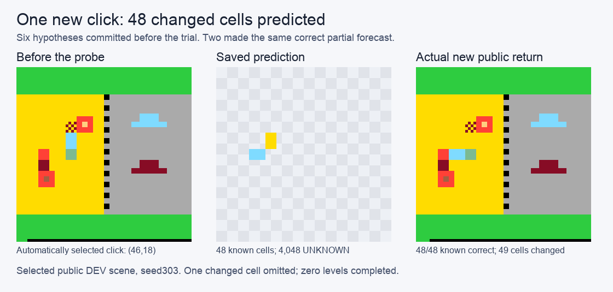

# A prospective coordinate-rewrite forecast

One new public ARC-AGI-3 transition changed 49 pixels. A saved partial forecast correctly specified 48 of them, with zero wrong claims; one changed pixel remained unclaimed. The forecast covered 48 of 4,096 cells, leaving 4,048 UNKNOWN, and made no state, level, action-set or goal prediction. Two candidates, `affine-d4-5` and `toggle`, supplied that identical forecast. Their agreement counts as one behavioral result; the mechanism remains unresolved.

The idempotent forecast was refuted on 24 precommitted common-cell witnesses. Two other supported forecasts each made 24 wrong claims, while one candidate abstained with zero accuracy credit. All six candidates remain in the files. Both frozen criteria, model discrimination and a correct dynamic prediction, passed on this selected transition. Zero levels completed; goal utility remains UNKNOWN. Transfer, goal planning, trigger invariance across the control, novelty, competitive accuracy and active/passive benefit remain untested. The preceding motion and spatial feasibility failures retain their original outcomes.

## Experiment and evidence

We selected the already responsive public D2 trace (`dc22-fdcac232`, seed303) after the earlier spatial study. A hand-written conservative rewrite family fitted the first qualifying transition in six public records, retaining four compatible D4-affine parameterizations, idempotence and toggle. Before fresh SDK initialization, it saved every forecast and common-cell disagreement for `(46,18)`, the first unused interior control pixel in row/column order. No point search, refit, repair or replacement game followed the return.

Earlier exposure totaled 96 actions in the four-arm spatial study, including the 24-action D2 episode. This reconstruction added seven actions: RESET, five setup clicks and one new probe. All six visible checkpoints matched; hidden-state equality was not established. The result is a public DEV component diagnostic with no completed solver or official score.

The measured source was frozen in commit `666f6dec9a0fd234dd032a0a19299a478f3e76bb`, closure `3b72230848f104da7345a738366925da5ccb2de588bedc7a64fa8d484b91e1c8`. One fit and six native forecasts ran, with zero LLM calls. Parent wall time was 0.376045709s; worker wall/CPU were 0.248690750/0.247870s, peak RSS 113,164,288 bytes. These costs exclude preparation and earlier observations.

The [protocol](research/click-rewrite-probe-protocol-20261030.md), [result discussion](research/click-rewrite-probe-results-20261030.md) and [root readout](artifacts/experiments/click-rewrite-probe-20261030-v1/readout.json) preserve the methods and all outcomes. A separate [data-only audit](artifacts/experiments/click-rewrite-probe-20261030-v1/independent-data-audit.md) confirmed the arithmetic without fitting, native prediction or SDK execution. It is same-family LLM advice; human and independent-model-family validation are absent. The [prior-work note](research/goal-plan-positioning-20261029.md) records conceptual overlap.



## Reproduce the saved-data arithmetic

The packet keeps original relative paths. Public observations, six-record input, fitted parameters, commitment, comparison input, slots, metrics, frozen protocol/config and root readout are byte-exact copies. The input-provenance receipt retains hashes from the preceding larger study, whose runtime artifacts are outside this packet and unnecessary for this calculation.

In a throwaway copy of the packet, from its root, run:

```sh
python3 -I -B artifacts/experiments/click-rewrite-probe-20261030-v1/readout.py
```

This standard-library script checks saved hashes and joins, then compares committed cells with returned pixels. It imports no learner, SDK or model and performs no fit, prediction, reconstruction or action. It overwrites the copy's `readout.json`, so preserve the published original. This reproduces data arithmetic; it supplies neither a new trusted timestamp nor independent runtime attestation or SDK gameplay reproduction.

`release-manifest.json` records source/released SHA256 and byte counts. One measured-metadata derivative is explicit: `run/request.json` publishes only the exact `source`, `config_sha256` and `protocol_sha256` fields used by the readout. Local absolute paths and the host monotonic deadline are omitted. The original request SHA256 and transformation remain recorded. Source, predictions, observations and metrics are unchanged.

The [learner](src/arc_paper/click_rewrite.py) uses only the standard library. The [measured runner](scripts/run_click_rewrite_probe.py) exposes execution order and custody; its three SDK-episode helper files are not redistributed, so it is not a standalone gameplay replay package. The original six-member source/hash map is retained. SDK distributions, game implementations/caches, cache inventory payloads, private scorecards, notebook/account metadata, credentials and weights are excluded.

The optional [figure renderer](artifacts/experiments/click-rewrite-probe-20261030-v1/render_forecast.py) reads saved data and requires Pillow. The included PNG needs no installation; fonts and Pillow versions may change rerendered bytes. Original code uses [MIT-0](LICENSE). Competition observations and referenced upstream assets retain their own terms; no game or SDK source is distributed. AI tools assisted source preparation and analysis. Contest eligibility has not been certified.
